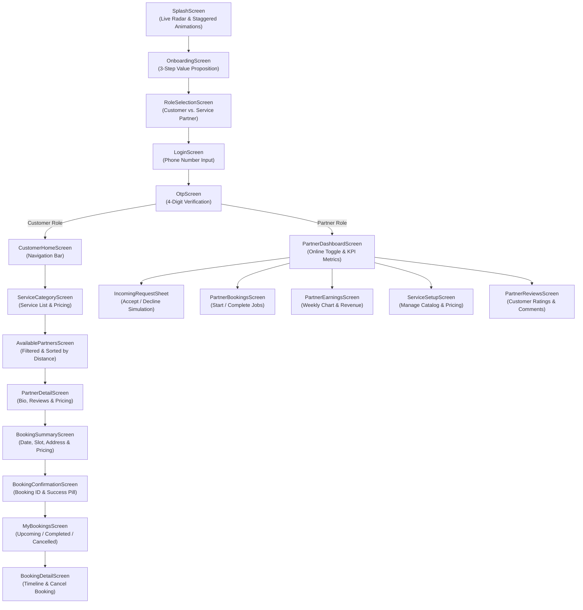

# 🚀 serviceAtEase — On-Demand Services Platform (Prototype)

<p align="center">
  
</p>

<p align="center">
  <strong>Instant Services. At Your Ease.</strong><br>
  <em>A modern, full-featured on-demand home, beauty, health, and maintenance service marketplace built with Flutter.</em>
</p>

<p align="center">
  
  
  
  
  
  
</p>

---

## 📖 Table of Contents

- [Overview](#-overview)
- [Key Features & Dual-App Architecture](#-key-features--dual-app-architecture)
  - [1. Customer Experience](#1-customer-experience)
  - [2. Partner / Service Provider Experience](#2-partner--service-provider-experience)
- [User Journey & Flow](#-user-journey--flow)
- [Screens & Navigation Map](#-screens--navigation-map)
- [Tech Stack & Architecture](#-tech-stack--architecture)
- [Project Directory Structure](#-project-directory-structure)
- [Getting Started & Installation](#-getting-started--installation)
- [Running Tests](#-running-tests)
- [Prototype Test Guide & Demo Scenarios](#-prototype-test-guide--demo-scenarios)
- [Design System & Theming](#-design-system--theming)
- [Future Roadmap](#-future-roadmap)
- [Contributing & License](#-contributing--license)

---

## 🌟 Overview

**serviceAtEase** is a cross-platform Flutter application prototype simulating a two-sided on-demand hyperlocal service marketplace (comparable to Urban Company, TaskRabbit, or Uber for local services). 

The app unifies **Customers** seeking immediate or scheduled household and wellness services with **Verified Service Partners** (barbers, beauticians, electricians, plumbers, doctors, trainers, and technicians) in real time.

### Core Value Proposition
- **Hyperlocal Dispatch**: Real-time radar highlighting service partners currently active within proximity.
- **Unified Codebase**: Dual-role architecture allowing users to seamlessly experience the platform as either a customer booking services or a service professional managing jobs and income.
- **Production-Grade Architecture**: Declarative routing with `go_router`, reactive state management with `provider`, atomic reusable components, and an adaptable modern theme.

---

## ✨ Key Features & Dual-App Architecture

serviceAtEase houses two interconnected interfaces inside a single Flutter mobile client:

### 1. Customer Experience
- **Fluid Staggered Onboarding**: Interactive introduction carousel with ambient glowing orbs and animated category badges.
- **Role Selection & Phone Auth**: One-tap toggle between Customer and Partner roles, followed by phone verification (accepts any 4-digit OTP for testing).
- **12 Diverse Service Categories**:
  - 💇 **Salon** (Haircut, Beard Trim, Hair Color, Head Massage, Shave)
  - 🌸 **Beauty** (Facial, Waxing, Makeup, Manicure, Pedicure)
  - 🩺 **Doctor** (General Checkup, Physiotherapy, Dental Checkup)
  - 🔧 **Plumbing** (Tap Repair, Pipe Fitting, Drain Cleaning)
  - ⚡ **Electrician** (Switch Repair, Fan Installation, Wiring Work)
  - 🧹 **Cleaning** (Full Home Deep Clean, Kitchen Clean, Bathroom Clean)
  - 🖌️ **Painter** (Room Painting, Wall Texture Finish)
  - 🪑 **Carpenter** (Furniture Repair, Door Fitting)
  - 💪 **Fitness** (1-on-1 Personal Training, Home Yoga & Meditation)
  - 📐 **Tutor** (Mathematics, Science & Academics)
  - 🪳 **Pest Control** (Cockroach Treatment, Anti-Termite Chemical Treatment)
  - ❄️ **Appliance Repair** (AC Service, Washing Machine, Refrigerator)
- **Live Search & Dynamic Filter**: Instant filtering across all categories and service types.
- **Partner Matching & Detail**:
  - Distance metrics (e.g. `0.8 km away`), star ratings, total verified customer reviews, and completed job milestones.
  - Complete professional bio, years of experience, and service pricing catalog.
- **Instant Booking Engine**:
  - Flexible date selection and slot selector (morning to evening half-hour intervals).
  - Pre-filled customer address with custom instructions and notes support.
  - Transparent itemized invoice breakdown (Base price + taxes + platform fees).
  - Instant booking confirmation with reference ID generation (`bk_...`).
- **Comprehensive My Bookings Hub**:
  - Segmented booking history: **Upcoming**, **Completed**, and **Cancelled**.
  - Detailed status tracker (`Pending` ➔ `Confirmed` ➔ `In Progress` ➔ `Completed`).
  - Self-serve booking cancellation with live state propagation.
- **Customer Profile**: User metadata, saved addresses, contact information, and account settings.

### 2. Partner / Service Provider Experience
- **One-Tap Duty Switch (Online/Offline Radar)**: Toggle online availability to instantly start or stop receiving client bookings.
- **Earnings & Financial Analytics**:
  - Daily, weekly, and monthly net income tracking.
  - Visual 7-day bar chart showing day-by-day revenue trends.
  - Detailed breakdown of completed jobs and average ticket value.
- **Simulated Incoming Job Dispatch**:
  - Floating dispatcher action on the dashboard that simulates real-time incoming booking requests with an interactive bottom sheet (`Accept` or `Decline`).
- **End-to-End Booking Operations**:
  - Complete control over booking status: Accept incoming jobs, trigger **"Start Job"** (`inProgress`), and **"Mark as Completed"** (`completed`).
- **Service Configuration**: Toggle services offered and adjust base pricing on the fly.
- **Ratings & Reviews**: Real-time inspection of customer ratings and textual feedback.
- **Partner Profile & Notifications Hub**: Manage professional qualifications, location coverage, and view real-time platform alerts.

---

## 🔄 User Journey & Flow



---

## 📱 Screens & Navigation Map

The application leverages `go_router` for structured, type-safe, and parameter-driven routing:

| Path | Screen Widget | Description |
| :--- | :--- | :--- |
| `/` | `SplashScreen` | Animated branded splash with ambient orbs and radar dispatch status |
| `/onboarding` | `OnboardingScreen` | 3-step feature highlight carousel |
| `/role-selection` | `RoleSelectionScreen` | Choice between Customer and Partner interfaces |
| `/login` | `LoginScreen` | Phone number entry with country code support |
| `/otp` | `OtpScreen` | 4-digit code verification entry point |
| **Customer Routes** | | |
| `/customer` | `CustomerHomeScreen` | Primary customer hub with 3 bottom tabs (Home, Bookings, Profile) |
| `/customer/category/:categoryId` | `ServiceCategoryScreen` | Sub-services catalog for a specific category |
| `/customer/partners` | `AvailablePartnersScreen` | List of online service providers for a category |
| `/customer/partner/:partnerId` | `PartnerDetailScreen` | Detailed partner portfolio, bio, reviews, and booking action |
| `/customer/booking/summary` | `BookingSummaryScreen` | Slot selection, order customization, and price computation |
| `/customer/booking/confirmation` | `BookingConfirmationScreen`| Order confirmation receipt and quick navigational links |
| `/customer/booking/:bookingId` | `BookingDetailScreen` | Order timeline, service details, and cancellation action |
| `/customer/bookings` | `MyBookingsScreen` | Filterable list of past and upcoming customer bookings |
| `/customer/profile` | `CustomerProfileScreen` | Customer account details and settings |
| **Partner Routes** | | |
| `/partner` | `PartnerDashboardScreen` | Partner command center with 4 tabs (Dashboard, Bookings, Earnings, Profile) |
| `/partner/bookings` | `PartnerBookingsScreen` | Active, upcoming, and completed provider orders |
| `/partner/earnings` | `PartnerEarningsScreen` | Weekly earnings bar chart and payout breakdown |
| `/partner/profile` | `PartnerProfileScreen` | Partner profile, business info, and settings |
| `/partner/services` | `ServiceSetupScreen` | Services offered checklist and base rate editor |
| `/partner/reviews` | `PartnerReviewsScreen` | Aggregated customer feedback and reviews |
| `/partner/notifications` | `NotificationsScreen` | Incoming request alerts and platform notifications |

---

## 🛠️ Tech Stack & Architecture

- **UI Framework**: [Flutter](https://flutter.dev) (Dart 3.13+)
- **State Management**: [`provider`](https://pub.dev/packages/provider) (`ChangeNotifier`, `MultiProvider`)
  - `AuthProvider`: Authentication state transitions, user roles, session preservation.
  - `HomeProvider`: Dynamic category retrieval, live search querying, and nearby partner filters.
  - `BookingProvider`: Multi-step checkout state, slot reservation, and order cancellations.
  - `PartnerDashboardProvider`: Real-time online toggle, revenue analytics, and job state mutations.
- **Routing**: [`go_router`](https://pub.dev/packages/go_router) 15.x
- **Typography & Icons**: [`google_fonts`](https://pub.dev/packages/google_fonts) (Poppins & Inter) & Material / Cupertino Icons.
- **Storage & Helpers**: Prepared with [`shared_preferences`](https://pub.dev/packages/shared_preferences), [`sqflite`](https://pub.dev/packages/sqflite), [`path`](https://pub.dev/packages/path), and [`path_provider`](https://pub.dev/packages/path_provider).
- **Data Engine**: `MockData` class hosting relational in-memory representations of users, service categories, service items, partner accounts, reviews, and bookings.

---

## 📂 Project Directory Structure

```plaintext
lib/
├── app.dart                    # ServiceAtEaseApp widget with MultiProvider & Router configuration
├── main.dart                   # Application entry point & SystemChrome UI overlay styling
├── data/
│   └── mock_data.dart          # Rich mock dataset (categories, services, partners, reviews, bookings)
├── models/
│   ├── booking_model.dart      # Booking entity & BookingStatus enumeration
│   ├── partner_model.dart      # Partner profile entity (ratings, experience, location)
│   ├── review_model.dart       # Customer review entity
│   ├── service_category_model.dart # Category definition (icons, colors, service list)
│   ├── service_model.dart      # Individual service item (base price, duration)
│   └── user_model.dart         # Customer user model
├── providers/
│   ├── auth_provider.dart      # Authentication, role toggle & session state
│   ├── booking_provider.dart   # Booking builder & active booking management
│   ├── home_provider.dart      # Categories, search queries & partner filtering
│   └── partner_dashboard_provider.dart # Online state, earnings KPIs & job workflows
├── routes/
│   └── app_router.dart         # GoRouter configuration & deep link definitions
├── screens/
│   ├── auth/                   # Role selection, Login, OTP verification
│   ├── customer/               # Customer flow (Home, Categories, Partners, Booking, Profile)
│   ├── onboarding/             # Intro carousel with slide indicators
│   ├── partner/                # Partner flow (Dashboard, Bookings, Earnings, Services, Reviews)
│   └── splash/                 # Staggered animated splash screen
├── theme/
│   ├── app_colors.dart         # Brand palette, category colors, gradients
│   └── app_theme.dart          # Light Theme configuration (buttons, inputs, cards)
├── utils/
│   ├── constants.dart          # Dimensions, padding, avatar sizes & onboarding copies
│   └── extensions.dart         # Formatting extensions (dates, currency, strings)
└── widgets/
    └── common/                 # Atomic UI components (Logo, GradientButton, RatingStars, StatusBadge)
```

---

## 🚀 Getting Started & Installation

### Prerequisites
- [Flutter SDK](https://docs.flutter.dev/get-started/install) (`>= 3.13.4`)
- [Dart SDK](https://dart.dev/get-dart)
- An active emulator/simulator or physical device (Android / iOS / macOS / Linux / Windows / Chrome)

### Step-by-Step Setup

1. **Clone the repository**:
   ```bash
   git clone <repository-url>
   cd prototype
   ```

2. **Install project dependencies**:
   ```bash
   flutter pub get
   ```

3. **Verify Flutter setup**:
   ```bash
   flutter doctor
   ```

4. **Run the application**:
   ```bash
   # Run on default connected device
   flutter run

   # Or run in Chrome (Web)
   flutter run -d chrome

   # Or run on an Android / iOS device
   flutter run -d <device-id>
   ```

---

## 🧪 Running Tests

The project includes unit and provider test suites covering state transitions, role switches, category filtering, booking creation/cancellation, and partner earnings calculation.

Run all tests via:
```bash
flutter test
```

Expected output:
```plaintext
00:01 +7: All tests passed!
```

---

## 🎯 Prototype Test Guide & Demo Scenarios

Here is how to test the primary user flows:

### Scenario A: Customer Booking Flow
1. Launch the app and view the animated **Splash Screen**.
2. Swipe through the **Onboarding Carousel** and tap **Get Started**.
3. On the **Role Selection** screen, choose **"I need services" (Customer)** and tap Continue.
4. Enter any 10-digit phone number (e.g. `9876543210`) and tap Continue.
5. On the OTP screen, enter any 4 digits (e.g. `1234`) to verify.
6. On the **Customer Home Screen**:
   - Browse the 12 categories or use the search bar.
   - Tap on **Salon** to view salon services (Haircut, Beard Trim, etc.).
   - Tap **"Find Professionals"** to view nearby barbers.
   - Select **Vikram Styles** to view his bio, rating, and customer reviews.
   - Tap **"Book Vikram Now"**.
7. In the **Booking Summary**:
   - Pick a date and time slot.
   - Review the order summary and tap **"Confirm & Book"**.
8. View the **Booking Confirmation** screen, then navigate to **"My Bookings"** to see your booking in the `Upcoming` tab.

### Scenario B: Partner Management & Simulated Dispatch
1. Logout from the Customer Profile or restart and choose **"I provide services" (Partner)** on the Role Selection screen.
2. Complete phone login and OTP verification.
3. On the **Partner Dashboard**:
   - Toggle the **Online / Offline switch** at the top right.
   - View your Daily, Weekly, and Monthly earnings KPIs and the Weekly Revenue Chart.
   - Tap the floating **"New Request"** action button to simulate an incoming customer booking.
   - Review customer details, distance, and payout in the **Incoming Request Sheet**, then tap **Accept**.
4. Switch to the **Bookings Tab**:
   - Tap **"Start Job"** to transition the booking to `inProgress`.
   - Tap **"Complete Job"** to mark it as `completed` and watch your earnings automatically update!
5. Navigate to the **Earnings Tab** to inspect payout summaries.

---

## 🎨 Design System & Theming

serviceAtEase implements a clean, accessible design language:

| Token | Color / Style | Purpose |
| :--- | :--- | :--- |
| **Primary** | `#6C63FF` (Electric Violet) | Primary branding, buttons, active indicators |
| **Secondary** | `#FF6584` (Coral Sunset) | Accents, badges, high-priority highlights |
| **Online Status**| `#00C853` (Vibrant Emerald) | Active partner radar, success indicators |
| **Background** | `#F8F9FE` (Cool Cloud) | Soft background for enhanced contrast |
| **Surface** | `#FFFFFF` (Pure White) | Card containers, bottom sheets, navigation bars |
| **Typography** | `Poppins` & `Inter` | Modern geometric hierarchy with optimal legibility |

---

## 🗺️ Future Roadmap

- [ ] **Real Backend Integration**: Connect with Firebase Cloud Firestore or a Node.js/Go GraphQL backend.
- [ ] **Live GPS Geolocation & Maps**: Google Maps / Mapbox SDK integration for live driver/partner tracking on route.
- [ ] **Push Notifications**: Real-time FCM notifications for incoming bookings, partner arrival, and completion.
- [ ] **Payment Gateway**: Stripe / Razorpay integration with support for UPI, Cards, and Digital Wallets.
- [ ] **In-App Realtime Chat & VoIP**: Audio calling and messaging between customers and partners.
- [ ] **Dark Mode Support**: Full system-adaptive dark palette.

---

## 📄 License & Attribution

This project is developed as a prototype demonstration for on-demand service delivery platforms.  
All brand assets, mock data, and designs are for prototype demonstration purposes.
